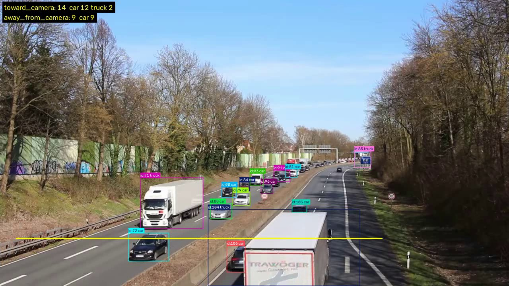

# Vehicle Counter

Counts vehicles by class and direction in traffic video: YOLO11 detection, ByteTrack tracking,
line-crossing count. Accuracy is measured against a hand-annotated ground truth, then the model is
exported to ONNX and TensorRT (FP16, INT8) and every variant is measured for speed **and** counting accuracy.


<sub>Frame from "Motorway A40 - on bridge above the traffic" by Kathinka Engels,
[CC BY 3.0](https://creativecommons.org/licenses/by/3.0/), annotated by this project.</sub>

## Results

Two fixed-camera motorway scenes, 40 hand-annotated line crossings
(A40: 25 s, 720p, 27 crossings; E18: 25–48 s, 1080p, 13 crossings).
RTX 3050 Laptop GPU (4 GB, plugged in), YOLO11n, imgsz 640.

| Variant | Model latency, median (p95) | End-to-end FPS, A40 / E18 | F1 | Class accuracy |
|---|---|---|---|---|
| PyTorch FP32 | 8.64 ms (11.84) | 57 / 51 | 1.000 | 40/40 |
| ONNX Runtime GPU FP32 | 6.38 ms (7.22) | 67 / 58 | 1.000 | 40/40 |
| **TensorRT FP16** | **1.73 ms (1.80)** | **98 / 76** | 1.000 | 40/40 |
| TensorRT INT8 | 1.62 ms (1.67) | 99 / 79 | 1.000 | 40/40 |
| ONNX Runtime CPU FP32 | 41.39 ms (46.39) | 20 / 19 | 1.000 | 40/40 |

- *Model latency*: forward pass only, 1×3×640×640, batch 1, 500 runs after 50 warm-up (`bench.py`).
- *End-to-end*: decode → detect → track → count, CSV output only (`run.py --no-video`), warm-up frames excluded.
  Writing an annotated video as well drops PyTorch from 57 to 26 FPS on the A40.

**Takeaways**

- **TensorRT is 5× faster on the model at no accuracy cost.** The gain comes from compiling the whole graph
  (fused layers, one call per frame), not from lower precision: in eager PyTorch at batch 1 the GPU waits on
  per-layer kernel launches, so FP16 gives nothing (9.5 vs 8.6 ms). At batch 16, where the GPU is busy,
  PyTorch FP16 is 1.6× faster than FP32.
- **INT8 is not worth it here**: +6% over FP16 on a network this small, plus a calibration step to maintain.
  It shifted confidences by up to 0.13 and dropped 1 of 12 boxes on a test frame, but the tracker's low-score
  second pass absorbed it and counts were unchanged. Worth re-measuring on a Jetson or a larger model.
- **The rest of the pipeline is now the bottleneck (Amdahl's law).** On the A40, ~7.5 ms per frame lies
  outside the model with both PyTorch and TensorRT (decode, letterbox, NMS, tracking): even an instant model
  would cap at ~130 FPS. Next target: video decoding, which weighs more at 1080p.
- **CPU only** runs at ~20 FPS with perfect counts: enough for a 25–30 fps camera if every third frame is skipped,
  or with a smaller input size.
- **yolo11n vs yolo11s**: same F1 and class accuracy on both scenes, s slower; n kept.

**How far these numbers go.** 40 crossings in daylight, fixed camera, flowing traffic: F1 = 1.000 means the
pipeline works under favourable conditions, not that it is error-free. One error moves the metrics by 2.5 points.

## How it works

```
video ─▶ YOLO11n (COCO: car, motorcycle, bus, truck) ─▶ ByteTrack ─▶ line counter ─▶ CSV
```

**Detection** (`run.py`). COCO-pretrained YOLO11n, confidence threshold 0.1: low on purpose, because ByteTrack's
second association pass uses weak detections to keep tracks alive; the tracker's own thresholds do the filtering.
`agnostic_nms=True`: per-class NMS kept both a "truck" and a "bus" box on the same lorry, and the tracker turned the
extra box into a second ID (113 → 93 IDs on the A40).

**Tracking** (`configs/bytetrack.yaml`). Kalman filter + IoU association (Hungarian algorithm) in two passes.
`fuse_score: False`: multiplying IoU by the detection score broke truck tracks whenever their confidence dipped
(93 → 84 IDs, short tracks 19 → 8). BoT-SORT with ReID and a longer track buffer gave no improvement and cost ~15% FPS.
Remaining ID switches happen after occlusions in the far part of the road, which is why the counting line sits in the
near zone.

**Counting** (`counting.py`, no YOLO/OpenCV dependency, unit-tested).
- Each vehicle is reduced to the bottom-centre of its box: the point on the road, same plane as the line.
- Side of the line = sign of the 2D cross product; a sign change on the same track ID is a crossing, and the
  crossing point must project inside the segment.
- One count per track ID (jitter on the line counts once); direction from the sign change.
- Class = majority vote over the whole track, not the class in the crossing frame.
- Known limit: a vehicle already past the line when first seen is not counted.

## Evaluation method

**Ground truth** (`annotate.py`). Step through the *original* video, with only the line drawn (no model boxes, to
avoid anchoring on the model's output), and press a key at the frame a vehicle crosses: the key gives the class,
Shift gives the direction. Output: `groundtruth/*.csv`, same columns as the model's CSV.

**Matching** (`evaluate.py`). Ground-truth and predicted crossings are paired one-to-one: same direction, within
±1 s, same-class pairs first, then the closest in time. Unpaired ground truth = missed vehicle (FN), unpaired
prediction = double count or false positive (FP). Reported: precision, recall, F1, count error per direction,
class confusion. Comparing events, not totals, because a missed car and a double count cancel out in the total.

**The ground truth needed fixing too.** The first A40 pass (`groundtruth/a40_v1.csv`) gave F1 0.945. Reviewing every
disagreement on the video found three annotation errors and no counter error:
1. Receding vehicles were annotated when their *front* touched the line, while the counter uses the box bottom,
   i.e. their *rear*: a systematic 6–13 frame lag, ~56 frames for a lorry still clipped by the frame edge.
   The rule became "the vehicle's lowest edge in the image", the same reference as the counter.
2. A car hidden beside a lorry had been missed.
3. One direction key was wrong.

Matching on time alone also once paired a car and a truck crosswise (they crossed one frame apart in different
lanes); same-class-first matching fixed it, with a regression test.

## Edge export

- **ONNX Runtime GPU** must match the CUDA of the PyTorch wheel: `onnxruntime-gpu` ≥ 1.27 on PyPI targets CUDA 13
  and silently falls back to CPU next to a CUDA 12.8 torch (36 ms instead of 9). Pinned to 1.26; importing torch
  first lets it reuse torch's CUDA DLLs, so no system CUDA install is needed.
- **TensorRT 10.16**, not 11: 11 removes the INT8 calibrator in favour of Q/DQ graphs built with NVIDIA ModelOpt,
  and Jetson's JetPack 6 is on 10.x. An `.engine` is built for one GPU and TensorRT version: build it on the target.
- **INT8 calibration** (`make_calib.py`): 500 frames from footage that is *not* evaluated (E18 0–24 s while the
  camera pans, two Chicago drone videos). MinMax calibration; ultralytics keeps the 26 detection-head layers out
  of INT8.
- **Fair benchmark**: `YOLO("x.pt").predict` letterboxes to 640×384 for PyTorch only, while the exports are fixed at
  640×640; `bench.py` feeds the same 640×640 tensor to every backend and synchronizes the GPU around each call.

## Failure case: high-altitude drone footage

On "Lake Shore Drive" (drone, cars 8–20 px seen from above) the COCO model finds almost nothing on the road at
imgsz 640. At imgsz 1920, 98% of detections are parked cars and 74% of frames have no detection on the road:
the view and object size are far from COCO. Fixing it needs fine-tuning on aerial data (e.g. UA-DETRAC, VisDrone),
not a threshold change. Not attempted: on the two fixed-camera scenes the COCO model leaves no headroom to measure.

## Reproduce

Tested on Windows 11, RTX 3050 Laptop GPU (4 GB, 30 W), NVIDIA driver 596.49, Python 3.12, PyTorch 2.11 + CUDA 12.8.
No CUDA Toolkit is needed: the PyTorch and TensorRT wheels ship their runtimes; the driver must support CUDA ≥ 12.8.

```powershell
uv python install 3.12
uv venv --python 3.12 --seed .venv
.venv\Scripts\Activate.ps1
python -m pip install -r requirements.txt   # points pip at PyTorch's CUDA index
python -m pytest                            # 16 unit tests: counting logic and event matching
```

Download the videos into `data/videos/` (see [DATA.md](DATA.md)), then:

```powershell
# count (annotated video + CSV of crossings next to it)
python src/counter/run.py data/videos/Motorway_A40_-_on_bridge_above_the_traffic.webm --scene configs/scene_a40.json --out runs/a40.mp4
python src/counter/run.py "data/videos/E18_nord_for_Ramsum,_Vestfold.webm" --scene configs/scene_e18.json --start 25 --out runs/e18.mp4

# accuracy against the ground truth
python src/counter/evaluate.py groundtruth/a40.csv runs/a40.csv

# annotate a new video (key = class, Shift = direction, d/a = frame step, u = undo, q = save)
python src/counter/annotate.py <video> --scene <scene.json> --out groundtruth/<name>.csv
```

Export and benchmark (the INT8 build takes ~6 minutes, FP16 ~4):

```powershell
python src/counter/make_calib.py            # data/calib/: 500 frames + dataset yaml
mkdir models; copy yolo11n.pt models\; cd models
yolo export model=yolo11n.pt format=onnx imgsz=640
yolo export model=yolo11n.pt format=engine imgsz=640 quantize=16 workspace=2 device=0; move yolo11n.engine yolo11n_fp16.engine
yolo export model=yolo11n.pt format=engine imgsz=640 quantize=8 data=../data/calib/calib.yaml workspace=2 device=0; move yolo11n.engine yolo11n_int8.engine
cd ..
python src/counter/bench.py
python src/counter/run.py data/videos/Motorway_A40_-_on_bridge_above_the_traffic.webm --scene configs/scene_a40.json --model models/yolo11n_fp16.engine --no-video --out runs/a40_trt16.mp4
```

## Repository

```
src/counter/
  run.py          detect + track + count; annotated video and CSV of crossings
  counting.py     line-crossing logic (pure Python)
  annotate.py     manual ground-truth tool
  evaluate.py     event matching and metrics
  make_calib.py   INT8 calibration frames
  bench.py        model-only latency per backend
configs/          tracker settings, counting line per scene
groundtruth/      hand-annotated crossings (a40_v1.csv: first pass, before the fixes above)
tests/            pytest: counting and matching
docs/             README image
```

## License

Code: Ultralytics YOLO is AGPL-3.0, so this repository is published as open source accordingly.
Videos and frames derived from them keep their own licenses, listed in [DATA.md](DATA.md).
